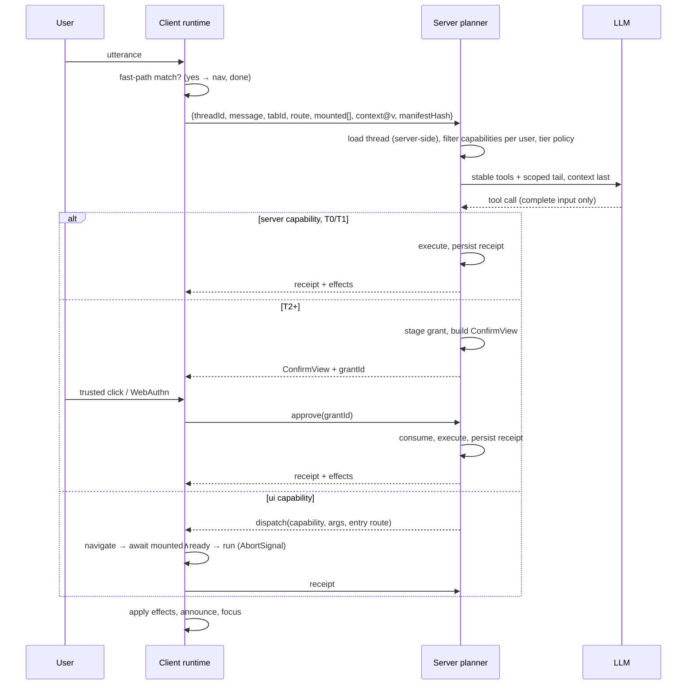

# Review + revised design: AI Navigation Layer → an app-capability standard

## Context

The user has a Cursor design plan (`~/.cursor/plans/ai_navigation_layer_0ddbba02.plan.md`) for an AI navigation/action layer on React 19 + Next.js App Router. They want it reviewed thoroughly, the facts checked, the edge cases taken beyond their own list (pasted), and the idea turned into a **standard** (protocol + framework), not just a library. The project folder (`/Users/logic-liar/Documents/React Ai framework`) is empty, so this is design work only.

**Update (DX contract):** the north star is developer ease. Developers should be able to let the AI navigate, make API calls, and make UI/UX changes with the least possible code. §0 adopts the user's six-rule DX contract, fixes where it contradicts itself or this review, and adds a cookbook for API calls and UI changes. §7 re-tags the MVP as the day-1/2/3 ladder.

**Architecture for "the assistant can do anything the developer allows"** (pages, on-screen content, data, UI actions, buttons, forms, Server Actions, APIs, MCP tools): see [ARCHITECTURE.md](ARCHITECTURE.md).

**Launch-readiness review** of the "perfect for millions" checklist against the real code, with corrections and fixes: [HARDENING.md](HARDENING.md).

**Decisions (from the user):** (a) UI scope is **declared UI actions only**; generative UI is out. (b) The MVP (Day 2) supports **all four API sources**: server actions, route handlers/REST, existing client mutations, and OpenAPI/tRPC import.

**After approval I will:** (1) rewrite the Cursor plan file with the fact fixes, the DX contract, the revised architecture, and the revised milestones; (2) draft `SPEC.md` v0.1 in the project folder from §6; (3) keep `plan/ai-navigation-layer-review.md` in sync.

---

## 0. Developer experience contract (north star)

**Goal:** a developer makes their app AI-operable (navigation, API calls, UI/UX changes) with the least possible code, and **the safe path is always the shortest path.** Every feature is measured against these six rules.

| # | Rule | Concretely | How we hold ourselves to it |
|---|---|---|---|
| 1 | **Zero-config default** | `npx ai-nav init` (or 3 small edits) makes every route the user can reach navigable, with a ⌘K palette | Time to first AI navigation ≤ 5 min, tested in CI on a fresh app |
| 2 | **One concept first** | `defineCapability` for actions, `useAction` for UI. Entities, tiers, exposure and taint all have defaults and stay hidden until needed | The getting-started doc mentions nothing else |
| 3 | **Declare, don't orchestrate** | The developer writes what an action does and how risky it is. The framework owns surfacing, scoping, confirmation, retries, receipts and emission | Demo apps contain zero prompts, tool schemas, confirm dialogs or selectors |
| 4 | **Safe by default, loud when risky** | Unspecified `risk` = `'destructive'` (✅ correct that MCP's `destructiveHint` also defaults to true). External exposure is off. Lowering risk is explicit and shows up in a PR diff | A committed capability lockfile (`ai-nav.capabilities.json`). CI fails on unreviewed tier downgrades or exposure widening |
| 5 | **Reuse what exists** | Types come from Zod and Next route types. Existing server actions and route handlers are reused (`withGrant`), and so is existing auth (`getUser` presets) | No type is declared twice |
| 6 | **Fails with a fix** | Every receipt code and dev warning carries a `fix` string | Unit test: every code has fix text |

### Where the contract contradicts itself or this review, and the fix
| Conflict | Fix |
|---|---|
| "Every route navigable by default" vs "deny-by-default visibility" | Navigation grants no privilege, because the page still enforces auth. So in-app nav is allow-by-default, and **deny-by-default applies to mutations and external exposure**. Routes that should be hidden by role get `access` in `nav.ts`. A proxy or auth bounce returns a `redirected` receipt, so the model tells the truth |
| Original plan says "headless only" vs "free ⌘K palette" | Ship a minimal default UI (palette, assistant input, confirm card, styled by CSS variables) that the provider mounts. `ui={false}` opts out. Headless primitives stay available for custom UIs |
| Day 2: "scoped to where it's mounted", but a server handler isn't mounted anywhere | Server capabilities are **available on every route**. They need no mounting, which also removes most cross-route dispatch problems. The framework surfaces them automatically: all schemas when the set is small, otherwise the route-relevant ones in full plus a `find_capability` meta-tool. Only `useAction`/`useCapability` UI capabilities are mount-scoped |
| Day 3: "`destructive` → … undo token" | Destructive means irreversible, so it has no undo. `reversible` is the undo tier, and it **requires an `undo` function at the type level**, so the claim can be checked |
| `db` calls inline in `defineCapability` | Only safe inside a `server-only` module. The client never imports server capabilities; the plugin finds them for the server registry. Otherwise database code leaks into the browser bundle |
| "3 lines" for day one | Honestly it's 3 edits plus a model key: `withAINav` in `next.config` (the manifest has to come from the build), the provider in the layout, and the route handler. `init` turns this into one command. Also, a root layout must render `<html><body>`, so the pasted one-line layout is invalid |
| Day 2 uses `ctx.user` | Needs a one-time `getUser` in `createNavHandler`, with presets for Auth.js, Clerk, Supabase and Better Auth |
| Day 3: "two fields, not two files" | Also needs **one entity declaration per model**, reused by every capability and route param. The entity holds the authz filter, so it can't be skipped |
| One-time grants need storage | Day 1 needs none (history is sealed with an HMAC signature, and `AI_NAV_SECRET` is auto-generated in dev). Dev mode uses memory. A production build with gated capabilities and no `store` fails with a fix pointing to Upstash, Redis or Postgres adapters |
| Pessimistic default puts a confirm card on "create draft" (over-gating) | Keep the default. The dev overlay says: *"posts.create has no risk, so it's treated as destructive. If it can be undone, use `risk: 'reversible'` + `undo`. If it's a normal write, use `risk: 'write'`."* The downgrade then shows in the lockfile diff |
| "Never weaken a gate by accident" | Covered by the type-enforced `undo`, the lockfile, and a lint warning when a `read` or `useAction` handler calls a server action or non-GET `fetch`. The lint only warns; it is never used for enforcement |

### The ladder, corrected: what the developer actually writes

**Day 1: the app is navigable** (or run `npx ai-nav init`)
```ts
// next.config.ts
import { withAINav } from '@ai-nav/next';
export default withAINav({ /* your existing config */ });
```
```tsx
// app/layout.tsx
import { AINavProvider } from '@ai-nav/react';
export default function RootLayout({ children }: { children: React.ReactNode }) {
  return <html lang="en"><body><AINavProvider>{children}</AINavProvider></body></html>;
}
```
```ts
// app/api/ai/route.ts
import { createNavHandler } from '@ai-nav/next/server';
import { anthropic } from '@ai-sdk/anthropic';
export const POST = createNavHandler({ model: anthropic('claude-sonnet-5-5') }); // any AI SDK model; pick by eval (gpt-4.1 in the original is dated)
```
That gives "take me to billing" on every static route, typed search-param changes, a ⌘K palette that works with the model off, and screen-reader announcements.

**Day 2: one API action and one UI action**
```ts
// capabilities/posts.ts
import 'server-only';
import { defineCapability, navigate } from '@ai-nav/core';
import { z } from 'zod';

export const createPost = defineCapability({
  id: 'posts.create',
  describe: 'Start a new draft post',
  input: z.object({ title: z.string().max(200).optional() }),
  risk: 'write',
  handler: async ({ title }, ctx) => {
    const id = await db.post.create({ title, authorId: ctx.user.id });
    return { effects: [navigate(`/posts/${id}`)] };
  },
});
```
```ts
// app/api/ai/route.ts: add once so ctx.user exists
export const POST = createNavHandler({ model: anthropic('claude-sonnet-5-5'), getUser: auth });
```
```tsx
// any client component: a UI action in one line
useAction('share.open', 'Open the share dialog for this post', () => setOpen(true));
```

**Day 3: one dangerous action** (two fields, plus one entity per model)
```ts
// entities/post.ts: once per model, holds the authz filter
export const Post = defineEntity({
  type: 'post',
  label: p => p.title,
  get:  (id, ctx) => db.post.findFirst({ where: { id, authorId: ctx.user.id } }),
  find: (q, ctx)  => db.post.search({ q, authorId: ctx.user.id }),
});
```
```ts
export const deletePost = defineCapability({
  id: 'posts.delete',
  describe: 'Permanently delete a post',
  risk: 'destructive',                     // → confirm card built from the real args, one-time server grant
  input: z.object({ post: Post.ref() }),   // → "delete it" resolves through Post.get (authz applied), no hallucinated IDs
  handler: async ({ post }) => {
    await db.post.delete({ where: { id: post.id } });
    return { effects: [navigate('/posts')] };
  },
});

// reversible variant: undo instead of confirm. The type requires `undo`.
export const archivePost = defineCapability({
  id: 'posts.archive', describe: 'Archive a post', risk: 'reversible',
  input: z.object({ post: Post.ref() }),
  handler: ({ post }) => db.post.archive(post.id),
  undo:    ({ post }) => db.post.unarchive(post.id),
});
```

### Cookbook: API calls and UI/UX changes
| The AI should… | Developer writes | Runs | Default tier |
|---|---|---|---|
| Go to any page | nothing | client nav | T0 |
| Open a specific record (`/posts/[id]`) | `params: { id: Post.param() }` in `nav.ts` | client nav | T0 |
| Change filters, sort, tab or page held in the URL | `search: z.object({…})` in `nav.ts` | client nav | T0 |
| Call an existing **server action** | `handler: myServerAction` in `defineCapability` | server | destructive until `risk` is set |
| Call an existing **route handler / REST API** from the client | `useCapability(cap, (args, ctx) => ctx.fetch('/api/x', …))` plus `export const POST = withGrant(handler)` | client → server | same; dev warning if the route didn't verify the grant |
| Reuse an existing **React Query / SWR / fetch** mutation | `useCapability(cap, (args, ctx) => mutation.mutateAsync({ ...args, headers: ctx.headers }))`, with the target route wrapped in `withGrant` | client → server | per `risk`. Here the args travel through the client, so `withGrant` compares the request body with the staged args (JCS on the parsed input) |
| Call an operation from an **OpenAPI** spec | `fromOpenAPI(spec, { include: ['listInvoices', 'refundInvoice'] })`, opt-in per `operationId`. Schemas and descriptions come from the spec | server (forwards the user's auth) | everything `destructive` until set. `methods: { GET: 'read' }` is a one-line opt-in |
| Call a **tRPC** procedure | `fromTRPC(appRouter, { include: ['post.create'] })` reuses the procedure's Zod `.input()` and `.meta({ description })` | server via `createCaller(ctx)` | mutations `destructive` until set. `queries: 'read'` is a one-line opt-in |
| Read data on demand ("how many drafts do I have?") | `defineCapability({ risk: 'read', handler })` | server | T0 |
| Open a modal or drawer, switch an in-state tab, toggle the theme | `useAction('share.open', 'Open the share dialog', () => setOpen(true))` | client | T0 |
| Point at something ("where do I change my avatar?") | `useAction(…, (_, ctx) => ctx.highlight(ref))` | client | T0 |
| Fill a form without submitting it | `useFormCapability(form)` (M5) | client | T0 (draft + diff) |
| Submit that form | the form's server action as a capability | server | per `risk` |
| Act on many rows | `input: z.object({ posts: z.array(Post.ref()).max(100) })`, registered **once** at list level, not per row | server | escalates to step-up above a count threshold |

Boundary, stated plainly: the AI can only invoke UI changes the developer declared. It never restyles or rewrites the UI, and it never touches the DOM directly. **Decided:** generative UI (the AI rendering components in chat or on the page) is out of scope. Imported OpenAPI and tRPC operations all appear in the capability lockfile, so every imported endpoint and its tier gets reviewed in a PR.

### Escape hatches (one per kind)
- `instructions`: brand voice and domain hints. They are appended and never replace the safety rules.
- `planner`: bring your own agent or AG-UI backend. The gate still applies at execution.
- `policy`: can only **raise** tiers. Lowering happens only through each capability's own `risk`.
- `store`, `getUser`, `ui`.
- `onReceipt`: for analytics, tagged `origin: 'ai'`.

---

## 1. Verdict

The plan is well above average. Its central rule, "derive what is canonical, declare what is dangerous", holds up, and the out-of-scope list is disciplined. It has four structural problems:

1. **Several cited facts are wrong, stale, or untraceable** (§2). Two citations look invented, and the main competitive argument (the CopilotKit issue) was fixed in a day.
2. **Enforcement sits in the wrong place.** "The client executor refuses to dispatch without a grant" is not a security boundary. The voice path (Realtime over WebRTC) skips the server planner entirely. Gated mutations have to be **executed and verified on the server**.
3. **The core nouns are incomplete.** There is no **Entity** concept. That gap is the root cause of your edge cases #4 (dynamic params), capability identity, hallucinated IDs, and "delete *it*" ambiguity. Apple App Intents and Android AppFunctions both solved this with entities plus queries. The plan cites neither.
4. **It is a framework, not yet a standard.** It has no wire format, no versioning, no conformance suite, and no plan for a second implementation. It also invents `/.well-known/actions.json` while saying "do not invent a rival protocol."

Your pasted edge-case list is strong and mostly correct. Four corrections are in §3. Thirty-plus further issues are in §4.

---

## 2. Fact-check of the plan

| Claim in plan | Status | Fix |
|---|---|---|
| Operator 68.6% on an independent re-run vs 87% reported | ✅ Confirmed (Emergence WebVoyager, arXiv 2603.29020, ICLR 2026) | Keep and cite |
| Agent-E 27.3% on Booking.com | ✅ Confirmed (arXiv 2407.13032 table) | Keep. **Google Flights 35.7%: not verified** |
| WebVoyager scores span 57.1–94.2% | 57.1% ✅ (WebVoyager multimodal baseline). 94.2% ❓ not found | Cite the source for 94.2 or drop it |
| "Vision 10–20× DOM cost, 2–3 s/page"; "WebArena −70% under network faults" | ❓ No source given or found | Cite or drop |
| CopilotKit #5369: ~30KB A2UI context in every run | ✅ Real, **but closed as fixed in 1 day** (opened 10 Jun 2026, fixed in PR #5383 on 11 Jun) | Reframe as a *failure class*, not an open weakness. Don't base differentiation on it |
| CopilotKit #2219: control of tool-list token cost | ⚠️ Partly. It was about the tool list being **sent twice** (prompt + `tools`). Closed as completed 17 Jul 2026 | Reword |
| WebMCP has "empty security and accessibility sections" | ❌ **Stale.** §6 Security & Privacy is now substantive (prompt injection, misrepresentation of intent, privacy leakage, mitigations). §7 Accessibility *is* still empty | Fix |
| WebMCP has "TODO on all four core method definitions" | ❌ **Stale.** Methods now have full algorithms. `provideContext`/`clearContext` were removed and replaced by `registerTool(tool, {signal})` | Fix |
| WebMCP getter moved `navigator` → `document` | ✅ The spec IDL is on `Document`. Secondary sources say `navigator.modelContext` is deprecated as of Chrome 150 | Keep |
| Origin trial in Chrome 149+ | ✅ Blink LGTM to experiment for M149–M156 | Keep. "Edge 150" ❓ unverified |
| Safari formally opposed (API design, privacy, security, duplication) | ✅ WebKit standards-positions #670, `position: oppose`. Also listed: i18n, portability, use cases, venue | Keep and extend |
| WebMCP usage ~0.78% of page loads | ❌ **Implausible.** Chrome origin trials are capped at roughly 0.5% of page loads and get disabled above that. No source found | Drop |
| WebMCP annotations | ➕ Missing from the plan: `readOnlyHint`, `consequentialHint`, `untrustedContentHint` | Map risk and taint to them directly |
| "OWASP AISVS C09-02" | ⚠️ The section is **C9.2 High-Impact Action Approval** (dev-branch 1.01 draft). 9.2.2 requires approval prompts that show **complete action details without truncation**. 9.2.3/9.2.4 require a **trusted classification** of each action. C9.1 covers budgets and loop control | Cite precisely. It directly backs your edge cases #1 and #2 |
| "Commit-token pattern used by Verflow and Agentheya" | ❌ **No trace of either product.** Likely hallucinated | Delete. Cite OWASP C9.2 and AI SDK approvals instead |
| AI SDK "deleted chat-store in v5 (−650 lines)" | ❓ ChatStore was *introduced* in the v5 alpha. Removal and line count not verified | Drop the anecdote |
| AI SDK "introduced `Agent` in v6" | ⚠️ `Experimental_Agent` existed in v5. v6 promoted it to `ToolLoopAgent` | Reword |
| Build on `addToolResult` | ❌ **Deprecated in v6.** Replaced by `addToolOutput` / `onToolCall`, and `addToolApprovalResponse` for approvals | Update |
| (Missing) AI SDK v6 has native human-in-the-loop | ➕ `needsApproval: boolean \| (input) => boolean`, `approval-requested` tool state, `addToolApprovalResponse` | Build the gate's UX *on* this and add what it lacks (§5.4) |
| OpenAI Realtime `POST /v1/realtime/client_secrets` | ✅ Confirmed. Nuance: one secret can open **multiple sessions until it expires**, and sessions **outlive** the secret | A short TTL alone doesn't cap cost (§4.8) |
| (Missing) Next 15.5 stable `typedRoutes` + `next typegen` | ➕ Next already generates route types from the file tree | Reuse it plus Next's build manifests instead of a custom tree walker |
| (Missing) Next 16 renamed `middleware` → `proxy` (Node runtime by default) | ➕ | Update wording. Proxy logic stays invisible to the manifest |
| EU AI Act Art. 14 requires proof a human approved each action (in your list) | ⚠️ **Overstated.** Art. 14 (human oversight) and Art. 12 (logging) apply to **high-risk** (Annex III) systems. A general in-app assistant usually isn't one. **Art. 50 transparency** (disclose that the user is talking to an AI) is what likely applies. Check current dates, since the Nov 2025 digital-omnibus proposal moved some timelines | Keep the audit log for its own sake, and add AI disclosure |
| Intercom Fin Guidance can't act; Chameleon Automations | ❓ Not checked | Verify before publishing |

---

## 3. Corrections to your pasted edge-case list

- **Arg-hash canonicalization (Gate mechanics):** Better to *not hash at all*. **Stage by reference.** The server keeps the validated, entity-resolved args under a `grantId`. The click sends only `grantId`, and execution loads the stored args. If hashing is ever needed (args crossing a trust boundary), use **RFC 8785 JCS** plus NFC normalization applied to the *parsed Zod output*, never the raw input.
- **#1 server-authoritative risk:** Correct, but incomplete. The server planner is **not the only path**. Realtime voice tool calls arrive in the browser over the WebRTC data channel, the client can `session.update` its own tools, and WebMCP/browser agents call the page directly. So risk must be enforced **at the mutation endpoint** (grant verified where the write happens), not just in the planner.
- **"A click is consent":** A click proves an input event, not a human. Browser agents (CDP-driven, Gemini-in-Chrome-style) produce **trusted** clicks and can press your confirm card themselves. Use tiered consent (§5.3): `event.isTrusted` for the click tier, and **WebAuthn user verification** for irreversible, money, or permission actions.
- **EU AI Act:** see §2. Art. 14 likely doesn't bind you, and Art. 50 likely does.

---

## 4. Issues beyond your list

### 4.1 Trust boundaries
1. **Forged conversation history.** `useChat` sends the full `UIMessage[]` back every turn by default. Any client-side script can rewrite earlier assistant tool calls, tool results, or approvals before the server replays them to the model. → Store threads **server-side**, send only the new message plus `threadId` (`prepareSendMessagesRequest`), and never trust client-echoed tool parts.
2. **Exfiltration ("lethal trifecta": private data + untrusted content + an outbound channel).** "Safe" capabilities leak data: `nav.goto('/search?q=<secret>')` lands in analytics and logs, `posts.create` with a public title, and markdown images in assistant output (``). → `nav.goto` accepts only typed internal routes and declared params (no free-form query or hash, no external URLs). The assistant UI never auto-loads remote images or links from model output. Outbound capabilities are always gated.
3. **Taint propagation.** Mark snapshot and entity fields `untrusted` (UGC). When a turn's context contains tainted content, outbound or irreversible calls in that turn can't drop below the confirm tier. Wrap untrusted data with spotlighting/datamarking. The CaMeL design (DeepMind 2025) is the principled version.
4. **IDOR through model-supplied IDs.** Even valid-looking IDs must be re-authorized. → **Opaque per-thread entity handles** (`post:h3`) mapped server-side. The model can only reference what the server surfaced, and injected text can't name arbitrary rows.
5. **The planner endpoint is a free LLM proxy** for any logged-in user ("ignore that, write my essay"). → Per-user token budgets, output caps, rate limits, off-task refusal. CSRF/Origin checks on custom route handlers (server actions have these built in, route handlers don't).
6. **Confused deputy.** By default the AI acts with the user's full privileges. → A `human-only` tier: credentials, MFA, account deletion, and ownership transfer are never on the AI surface. The AI can only deep-link to the human UI.

### 4.2 Execution model
7. **Parallel tool calls.** Models emit them, and two navigations, or a navigation plus a UI mutation, will race. → Serialize side-effecting calls in an executor queue, or set `parallel_tool_calls: false` / `disable_parallel_tool_use`.
8. **Human interruption.** If the user clicks, types, or navigates mid-turn, the AI must yield. → Every handler gets an `AbortSignal`, and any human navigation cancels pending continuations. Rule: **the human always wins.**
9. **Unsaved changes.** AI navigation off a dirty form destroys work. The App Router has no general navigation-blocking API (Link's `onNavigate` covers only Link). → Ship a `useNavigationGuard` the executor consults. The receipt is `blocked: unsaved_changes`.
10. **AI writes vs human edits.** Form-fill must write to *draft* state and show a diff, never overwrite dirty fields, never auto-submit.
11. **Undo beats confirm.** The fix for over-gating isn't fewer gates. For reversible writes, execute and then offer **undo** (soft delete plus an undo token in the receipt). Confirm only what can't be undone.
12. **Dispatch on partial input.** Only act on the `input-available` tool state. (Your list notes the streaming risk; this is the concrete AI SDK rule.)

### 4.3 React / Next internals
13. **`<Activity>` (React 19.2).** Next 16 Cache Components can keep previously visited routes alive while hidden, and hidden Activity unmounts effects. Registration **must** happen in effects, never during render, or hidden routes leave ghost capabilities. (Check against your target Next version.)
14. **Use `useEffectEvent`** (stable in React 19.2) for the latest-handler problem instead of hand-rolled latest-refs.
15. **`router.push` returns void.** "Navigate then wait" has to watch the pathname change plus registry readiness, with a timeout. Don't await the push.
16. **Route-tree shapes the plan ignores:** route groups `(x)` (not in the URL), parallel routes `@slot` (not URLs), intercepting routes `(.)photo/[id]` (modal vs full page: which one does `nav.goto` target?), private folders `_x`, `generateStaticParams` (enumerable params for free).
17. **Unknown exports on `page.tsx` fail Next's type check**, so per-route AI metadata can't live there. → Colocate it in a non-route file (`app/posts/[id]/nav.ts`). App Router colocation is safe by default.
18. **Deploy skew.** Pair a `manifestHash` on every request with Next's `deploymentId` / skew protection. On mismatch, refuse the affected capabilities with `reload_required`. Never execute against a different schema version.

### 4.4 Model and cost
19. **Scoping fights prompt caching.** Provider prompt caches key on the prefix, *including the tools array*. Per-route tool surfaces save tokens but can lose cache hits on every navigation. → Use a stable core set first, sorted deterministically, then the scoped tail, with the snapshot last. **Measure cost and latency with caching on**, not just token counts. This undercuts the plan's headline metric if ignored.
20. **Latency for trivial intents.** "Take me to billing" shouldn't take a 2–3 s LLM round trip. → A deterministic **fast path**: fuzzy-match route titles and aliases locally, and call the LLM only on a miss.
21. **No-AI fallback.** The same manifest powers a **⌘K command palette**. That gives you real degradation for outages and 429s, a keyboard and accessibility path, and value even when AI is off.
22. **"No AI-only capabilities" rule.** Every capability must have a human UI path. This keeps the fallback honest and avoids accessibility dead ends.
23. **Description-quality evals are in scope.** You need golden utterance → capability suites, plus the overlap linter, plus a mock planner. Dashboards stay out; `ai-nav test` stays in.
24. **Injection corpus.** Base it on AgentDojo-style payloads and place them in every channel: snapshot fields, entity titles, receipts, handler error strings, route titles, and filenames. Never return raw handler error strings to the model. Return a developer-authored `code` plus `hint`.

### 4.5 Multi-tab and session
25. **Bind each thread to a `tabId`** and elect the active tab with BroadcastChannel. Every turn carries `{tabId, snapshotVersion}`, and receipts from another tab are rejected.

### 4.6 Emission
26. **Exposure is per consumer.** Each capability declares `expose: { assistant, browserAgent, external }`, all defaulting to `assistant` only. Non-interactive callers get `read`/`ui` only. Gated tiers are refused unless the developer opts into out-of-band approval (MCP elicitation, URL mode or a push to the user's device).
27. **Map risk to existing annotations:** MCP `readOnlyHint` / `destructiveHint` / `idempotentHint` / `openWorldHint`, and WebMCP `readOnlyHint` / `consequentialHint` / `untrustedContentHint`. Both specs treat these as *hints*, so our server-side enforcement stays authoritative.
28. **WebMCP limits.** Secondary sources report caps of 500 characters for descriptions, 150 for parameters, and 1.5K for output. Lint descriptions against the tightest target.
29. **Drop `/.well-known/actions.json`.** Emit MCP (and its discovery mechanism) and WebMCP. Inventing a well-known file contradicts the plan's own rule.

### 4.7 Accessibility (the spec's empty §7 is your opportunity)
30. Announce AI navigation in a live region ("Assistant opened Billing"), move focus to the new page's `h1`, honor `prefers-reduced-motion` for AI-driven scrolling, keep the confirm card keyboard- and screen-reader-complete, and use a default of `push` (not `replace`) so Back undoes AI navigation.

### 4.8 Voice
31. **Cascaded voice first** (STT → the *same* text planner → TTS). That keeps one planner and one security model. Realtime/WebRTC comes later as a latency optimization, because its tool calls go to the browser, not your server.
32. Client secrets can open several sessions and sessions outlive the TTL. → Pin session config server-side, cap concurrent sessions and duration per user, meter usage.
33. Voice can only *stage* gated calls, never approve them (agreeing with your list). Voice also needs a "repeat back" step for any staged action.

### 4.9 Data governance
34. The audit log holds args (PII). → Redact by schema tags, set a retention policy, make the log append-only and tamper-evident (hash-chained), and record `{user, thread, capability@version, args(redacted), tier, grantId, approver, consent method, model, manifestHash, outcome}`.
35. **Model provider data processing.** Snapshot opt-in field lists also need a per-field `pii` tag and a server-side redaction pass before anything leaves for the provider.

---

## 5. Revised architecture

### 5.1 Nouns: from 2 to 4 (each one earns its place)
| Noun | Why it exists | Prior art |
|---|---|---|
| **Capability** | Invocable unit: id, version, input schema, effect profile, scope, exposure | App Intents, AppFunctions, MCP tools |
| **Entity** | Typed referents with server resolvers, opaque handles, and display fields. Fills dynamic route params and capability targets. Solves #4, identity, hallucinated IDs, and "delete it" | App Intents `AppEntity` + `EntityQuery` |
| **Route** (derived) | Built from Next build output and typegen, plus colocated `nav.ts` for title, aliases, param→entity, access, exposure | Next typed routes |
| **Context** (was Snapshot) | Small always-on summary (budgeted, typed, PII/untrusted tags, `version`) plus on-demand `read` capabilities for anything larger | CopilotKit readables, scoped |

### 5.2 Three capability kinds (this removes most of edge case #3)
- **`server` capability:** executes on the server and returns `{result, effects}`, where effects are declarative client actions (`navigate`, `refresh`, `toast`, `openModal(id)`). It **doesn't need to be mounted**, so "create post from /billing" needs no cross-route continuation: execute on the server, then apply `navigate('/posts/abc')`. Grant verification, idempotency, receipts, and audit all sit here. **All gated writes must be this kind.**
- **`ui` capability:** client-only and mounted (open a dialog, switch a tab, fill a form draft). Only this kind needs the continuation protocol: navigate to the declared `entry` route, wait for `mounted ∧ ready`, then dispatch, with a timeout and a `not_ready` receipt.
- **`nav`:** derived, typed internal routes only. Params are filled by entity handles or enumerated values. Routes with unsatisfiable params are withheld.

Resolver states per capability, all explicit with reason codes: `declared → permitted(user) → in-scope(route) → mounted → ready`.

### 5.3 Effect profile → consent tier (server-evaluated, args-aware like `needsApproval(input)`)
| Tier | `risk:` keyword (§0) | Applies to | Consent | Non-interactive callers |
|---|---|---|---|---|
| T0 none | `'read'`, `useAction`, nav | read, ui, internal nav | — | allowed if exposed |
| T1 undo | `'reversible'` (requires `undo`) | reversible writes to own data | execute + undo token | opt-in |
| T2 confirm | `'write'` | irreversible single-target writes, outbound (send, invite, share), anything in a tainted turn | card + `isTrusted` click | refused by default |
| T2→T3 | `'destructive'` (**default when unspecified**) | deletes; bulk irreversible, money, permissions, export | card with full details. Step-up (typed confirm **or** WebAuthn UV) when bulk, money or permissions are involved | refused |
| T4 human-only | `'never'` | credentials, MFA, account deletion, ownership | never offered; AI may deep-link to the human UI | refused |

Tier = f(effect profile, args such as count or amount, taint), computed **only** on the server from its own import of the definitions. The client sends candidate IDs and mount state, nothing else.

### 5.4 Grant lifecycle (built on AI SDK v6 approvals, with what they lack added)
`staged → presented → approved | denied | expired → consumed`.
- Server stores `{grantId, user, session, thread, tab, invocationId, capability@version, manifestHash, args (validated + resolved), tier, expiresAt}`.
- The confirm card renders a **server-built `ConfirmView`** (structured title and field list from the capability's `confirm.view(args)`), never model prose. Model prose may appear beside it, labeled as such. Full details, no truncation (AISVS 9.2.2). The same JSON maps onto MCP elicitation and MCP Apps.
- Consumption is atomic and one-time (`UPDATE … WHERE state='approved' RETURNING`). `invocationId` doubles as the idempotency key. Expiry fails closed with an `expired` receipt and no auto re-stage.

### 5.5 Turn protocol

Receipts are persisted **before** responding. On reconnect the client reconciles from the server thread, so the transcript always matches reality.

### 5.6 Developer API (advanced form)
The everyday API is the §0 ladder: one `risk` keyword and an inline handler. The full form below is for apps that outgrow the defaults. Only `id`, `describe`, `input` and `handler` are required.
```ts
export const deletePost = defineCapability({
  id: 'posts.delete', version: 2,
  describe: 'Permanently delete one post the user owns',
  input: z.object({ post: Post.ref() }),
  effect: { write: true, reversible: false, outbound: false, bulk: false },        // replaces `risk`
  confirm: { view: ({ post }) => ({ title: `Delete "${post.title}"`, danger: true }) }, // default view is generated from input + entity labels
  scope: { routes: ['/posts', '/posts/[id]'] },  // relevance hint for server caps; hard filter for UI caps
  can: user => user.role !== 'viewer',
  expose: { assistant: true, browserAgent: false, external: false },
  handler: async ({ post }, ctx) => { /* … */ },
});
```
```ts
// app/posts/[id]/nav.ts: colocated, not a route file
export default defineRoute({
  title: 'Post editor', aliases: ['edit post'],
  params: { id: Post.param() },
  search: z.object({ tab: z.enum(['content', 'seo', 'history']).optional() }), // URL state gives a free UI capability
  access: user => !!user,
});
```
Where code runs follows the API you chose, not a guess. `defineCapability` with a `handler` runs on the server, so its module must be `server-only`. `useAction` and `useCapability` run in the client. `withGrant(handler)` wraps *existing* route handlers and server actions, and `ctx.fetch` attaches the grant and idempotency headers automatically.

---

## 6. The standard (spec outline for `SPEC.md` v0.1)

Position: **a declaration and consent layer that compiles to existing wire protocols** (AI SDK tools, MCP tools, WebMCP, AG-UI frontend tools), not a new transport. The parts worth standardizing are the ones those protocols lack: **entities and handles, scope/readiness semantics, consent tiers and grants, receipts.**

1. Terminology, plus conformance levels: **L0** route manifest + palette · **L1** capabilities + receipts · **L2** consent tiers + grants · **L3** external emission
2. Capability descriptor (JSON Schema 2020-12 subset compatible with OpenAI strict mode and MCP)
3. Entity descriptor and handle format
4. Route manifest (patterns, param→entity/enum, access, exposure)
5. Invocation envelope: `invocationId, threadId, turnId, tabId, capability@version, manifestHash, args, origin(assistant|voice|browser-agent|external), contextVersion`
6. Receipt: `status` enum (`ok | denied | expired | precondition_failed | not_ready | blocked | timeout | reload_required | error`), machine `code`, `retryable`, `hint` (developer-authored), route before/after, effects, `undo?`, taint flags
7. Grant state machine and consent tiers, plus non-interactive policy
8. Emission mappings (MCP and WebMCP annotations, AI SDK, AG-UI)
9. Versioning and negotiation (additive minors; `deprecated`; skew handling)
10. Security considerations (threat model table from §4.1), **mandatory, not empty**
11. Accessibility considerations (§4.7), **mandatory**
12. Conformance test suite: canonical test vectors, injection corpus, mock-planner fixtures

Process: a public spec repo with an RFC process. **v1.0 only after a second independent host implementation**, to prove the spec isn't Next-shaped. TanStack Router's generated route tree or React Router v7 framework mode are natural candidates. Later, propose the consent/grant piece upstream as an MCP extension (MCP Apps showed that path works). Name check: avoid "ACP" (already used by IBM Agent Communication, OpenAI/Stripe Agentic Commerce, and Zed Agent Client), `agents.json`, and `actions.json`.

---

## 7. Revised build order: the ladder is the MVP

Each milestone ends with a demo of exactly the code a developer writes at that rung. Hardening and emission come after the ladder works.

**M0: paper first.** Write the day-1/2/3 code for 3 paper apps (CMS, SaaS billing, CRM list with bulk actions) before any implementation. Draft spec v0.1 and the threat model from the result.

**M1, Day 1: "my app is navigable"** (`withAINav`, provider, handler, or `npx ai-nav init`)
- `@ai-nav/next`: manifest from Next build output and typegen (groups, parallel, intercepting, catch-all, i18n, basePath, trailing slash), colocated `nav.ts` with `search` schemas, `init` codemod
- `nav.goto` with typed params. Dynamic routes are withheld until they have an entity. `redirected` receipts on proxy or auth bounces
- Fast path, a default ⌘K palette (opt-out), live-region announcements and focus handling, AI navigations use `push`
- Planner on AI SDK v6: sealed history, stable tool prefix, budgets and rate limits, `input-available`-only dispatch
- Demo: "take me to billing", "show unpaid invoices" (search params), ⌘K with the model switched off

**M2, Day 2: "one action"** (one declaration, plus `getUser` once)
- `defineCapability` with a server handler, plugin discovery, declarative effects, the `risk` keyword with `'destructive'` as the default, an in-memory grant store for dev
- **All four API sources (decided):**
  - server actions as handlers
  - route handlers/REST through `withGrant` and `ctx.fetch`
  - existing client mutations through `useCapability` and `ctx.headers` (body compared with the staged args by JCS)
  - `fromOpenAPI`/`fromTRPC` imports: opt-in per operation, `destructive` by default, one-line `read` opt-in for GET or queries, auth forwarded server-side
  
  Because of this, `withGrant` and the confirm card move up into M2.
- Automatic surfacing: everything when the set is small, otherwise scoped full schemas plus `find_capability`
- `useAction` for UI. The `useSyncExternalStore` registry with effect-time idempotent registration, `useEffectEvent` handlers, an executor queue with AbortSignal and human-interrupt cancel, the navigation guard
- Dev overlay: tool surface per route, token count, receipts, a fix on every warning. The capability lockfile is generated
- Demo: "start a post titled Launch Notes" **from /billing**, "open the share dialog", and "refund invoice 1042" through an imported OpenAPI operation

**M3, Day 3: "one dangerous action"** (two fields, plus one entity per model)
- `defineEntity` and handles, `reversible` with type-enforced `undo`, a server-built `ConfirmView` driven by entity labels, one-time grants with a production store adapter (a production build without one fails with a fix)
- Demo: "delete it" on `/posts/[id]`; "archive these 3" with undo; an injection payload in a post body can't delete anything

**M4: hardening.** Injection corpus across all channels, mock planner, conformance suite, the **hostile demo** (500-row list with bulk delete, tabbed settings, feature-flagged page, proxy-gated page, dirty form, intercepting modal route, i18n prefix), deploy-skew handling, multi-tab binding, analytics tagging, hash-chained audit log, the lockfile CI check

**M5: forms.** `useFormCapability` with react-hook-form, TanStack Form and Conform adapters. Draft plus diff, never auto-submit

**M6: emission.** MCP bridge (annotation mapping, non-interactive policy), then WebMCP (feature-detect `document` then `navigator`, AbortSignal lifecycle, no double registration)

**M7: voice.** Cascaded first. Realtime only once mutation-endpoint enforcement is proven

---

## 8. Verification (replaces the plan's 5 criteria)

- **DX:**
  - On a fresh Next 15.5+/16 app, `npx ai-nav init` reaches the first AI navigation in ≤ 5 minutes.
  - A test fixture keeps each ladder rung at its stated size.
  - The demo apps contain zero prompt strings, tool schemas, confirm dialogs or selectors.
  - Every receipt code and dev warning has `fix` text, enforced by a unit test.
  - Target client runtime ≤ 15 KB gzip, with the palette lazy-loaded.
- **API sources:** the same "archive post" action works through all four paths: server action, `withGrant` route, client mutation, and OpenAPI/tRPC import. Each path refuses to run without a valid grant, and refuses when the request body doesn't match the staged args.
- "Take me to billing" uses the fast path with no LLM call. p50 is measured, and the LLM path still works.
- "Start a post titled Launch Notes" **from /billing** executes server-side and lands on `/posts/:id`. The receipt shows the route change.
- "Delete this post" stages a grant and shows a `ConfirmView` built from the stored args. Forged `approve` calls (replayed, expired, wrong user or tab, edited args) all fail.
- Injection suite: payloads in post bodies, entity titles, receipts, error strings, and route titles produce **zero** T2+ executions without consent, including when the system prompt is contradicted.
- Forged-history test: a client-modified `messages[]` has no effect, because the server thread is authoritative.
- Exfiltration test: no AI path can produce an external URL, a free-form query string, or a remote image load.
- Cost: tokens **and** dollar cost **with prompt caching on**, scoped vs unscoped, over a scripted multi-route session.
- React: passes under StrictMode, under hidden `<Activity>` (no ghost tools), and with unmount mid-flight (receipt still lands).
- Reliability: a dropped stream after execution reconciles on reconnect, deploy skew returns `reload_required`, and a provider 429 falls back to the palette.
- Accessibility: a screen reader announces AI navigation, focus moves correctly, and the confirm card is fully usable by keyboard.

## 9. Implementation status (2026-10-17)

Built in this repo: `packages/core`, `packages/react`, `packages/next`, `examples/next-demo`, [SPEC.md](../SPEC.md) v0.1, [README.md](../README.md).

### Milestones

| Milestone | Status |
|---|---|
| M0 paper + spec | SPEC.md v0.1 drafted. The 3 paper apps are still to do |
| M1 Day 1 | **Done.** Scanner (groups, slots, interceptors, private folders, catch-alls), `withAINav` with a dev watcher, nav tool, fast path, ⌘K palette, live-region announcements and focus, sealed history, rate limit, same-origin check |
| M2 Day 2 | **Mostly done.** Server capabilities, `risk` keyword (destructive default), `useAction`, `useCapability` + `withGrant` + `ctx.fetch`, confirm card. **Open:** `fromOpenAPI`/`fromTRPC`, dev overlay, capability lockfile |
| M3 Day 3 | **Mostly done.** `defineEntity` + handles, reversible with type-enforced `undo`, server-built ConfirmView, single-use grants with outcome replay, tier 3 typed step-up. **Open:** durable Redis/Postgres store adapters (production fails with a fix unless `store: 'memory'`) |
| M4–M7 | Not started (an injection test and a hostile-ish demo exist; the full corpus does not) |

### Verified

- **58 Vitest tests.**
- **Production build** (`next build`, Turbopack, TypeScript) passes.
- **Real HTTP end to end** against `next start` and `next dev`:
  - trusted vs untrusted approval
  - replay without duplication
  - injected post shows a real-args card and nothing is deleted
  - undo exactly once
  - `withGrant`: 403 for the wrong post, 200 for the right one, 410 on replay
  - cross-site 403
  - deploy-skew `reload_required`
  - live pickup of new routes in dev

### Deviations from the plan (decided during implementation)

- **AI SDK 7 is current** (7.0.143), not v6. It deprecated `needsApproval` in favor of `toolApproval`. The engine therefore **owns the tool loop** and uses `generateText` with tools that have no `execute`, so consent never depends on SDK approval APIs.
- **The provider is imported from `@ai-nav/next/client`**, not `@ai-nav/react`. The react package is router-agnostic.
- **One handler export:** `createNavHandler` is POST-only, and the manifest is fetched with `{ type: 'manifest' }`. This keeps Day 1 to a single export.
- **`entityRef<T>('post')`** was added for capability declarations the browser imports. `Post.ref()` would bundle resolver and database code.
- **Thread state is HMAC-sealed** and carried by the client, rather than stored server-side. It is tamper-proof and needs zero config.
- **`withGrant` semantics:** requests *without* a grant header pass through (the human path). Requests *with* one need a matcher or exact JCS equality with the approved args.
- **Entities resolve per engine** (route params + schema metadata), with a global registry only as fallback. Two engines in one process cannot collide.
- **TypeScript 6.0.3 is pinned.** TS 7 is the native compiler and has no JS API, which Next's type-check needs.

## 10. Update (2026-10-18): Saydo

The framework is now **Saydo** ("Say it. It's done."), shipped as one npm package `saydo` plus `create-saydo-app`. User decisions this round:

- **Full freedom, the developer restricts.** The model sees the visible page and can operate every element by default. The developer limits it with attributes (`data-saydo-private`, `data-saydo="off"`, `data-saydo-risk`, `data-saydo-untrusted`) and config (`see`, `act`). Risk is never guessed: unannotated clicks confirm.
- **Installable like Next.js:** `npx create-saydo-app my-app` (Next.js or Vite + React Router templates), `npx saydo-js init` for existing apps.
- **A complete README** with how-to, advantages, safety model, CLI and API reference.

Built since §9:

- page vision + `page_act` with server-side element risk and grants
- `serverAction()` (one function for UI and assistant, auto-discovered)
- `Post.ref({ as: 'id' })`
- `mcp()`, `aiTools()`, `fromOpenAPI()`, `fromTRPC()`
- `find_capability` tool search
- `never` actions hidden from the model
- Vite plugin + React Router provider + production Node server
- `saydo.config.ts`, zero-boilerplate `export { POST } from 'saydo-js/next/route'`
- lockfile with tool sources
- CLI (`init`, `ask`, `inspect`, `actions`, `routes`, `doctor`), dev inspector
- esbuild + d.ts build (ESM, a CJS `withSaydo` for `next.config` `require()`, a single `'use client'` client bundle)

Verified: 90 tests. Both templates were scaffolded with `npx` from packed tarballs, `npm install`ed, built and served, and the CLI was run against the installed app. Real-install testing caught and fixed two bugs that monorepo testing missed: the `require()` exports condition for `next.config`, and bundlers resolving the optional `@ai-sdk/mcp`.

**Publishing (needs the owner's npm account):**

```bash
cd packages/saydo && npm publish
cd packages/create-saydo-app && npm publish
```

## 11. Update (2026-10-18): hardening round complete

The "perfect for millions" review ([HARDENING.md](HARDENING.md)) is now fully worked through. Every production, scale and external-reach item is met. The remaining 🗺 items are listed below.

Built in this round:

- **Exactly once:** request idempotency (`requestId`, a client retry, stored responses) and invocation claims. At approval, TOCTOU re-resolve through `entity.get`, plus `entity.version`.
- **Durable stores:** `postgresGrantStore` (PGlite: 20 concurrent approvals produce exactly one execution) and `redisGrantStore` (single-key Lua, contract-tested on a real `redis-server`).
- **Consent:**
  - batched confirmations and a per-request `confirmBudget`
  - WebAuthn step-up with dependency-free WebCrypto verification, plus `usePasskeys` and passkey stores
- **Agents:**
  - `engine.invoke` / `approveDelegated` / `grantStatus`, and an MCP server (`saydo-js/next/mcp`, `createMcpHandler`) with delegated approval
  - an approval page (`saydo-js/next/approve`, `<SaydoApproval>`)
  - WebMCP registration (`<SaydoProvider agents>`)
- **Operations:**
  - redaction, a hash-chained audit log, a circuit breaker and per-user budgets
  - OpenTelemetry-compatible `tracer`, `pricing` → `costUsd`, cached-token accounting, per-page token estimates in `saydo inspect`, and `deploymentId` in audit and manifest
- **Reach:** `saydo-js/dom`, a framework-free client and UI (no React, about 18 KB gzip).
- **Standard:**
  - SPEC v0.2: delegated approval §6.5, step-up §6.6, agent requests §7.1, MCP server mapping §10, versioning and must-ignore §14
  - an [IP-POLICY.md](../IP-POLICY.md) draft (CC BY 4.0 spec, OWFa 1.0 patent commitment, DCO, RFC process) and CONTRIBUTING.md
- **Release engineering:** GitHub Actions CI (Node 20/22/24, real Redis, typecheck, tests, build, exports check, template sync, example builds, an npx install from tarballs). The release workflow publishes with `npm publish --provenance` on `v*` tags.

Verified: 153 tests at that point, a clean `tsc`, a clean package build, and all 17 exports resolving in plain Node.

Still on the roadmap (🗺):

- voice input and streaming responses
- Pages Router and TanStack Router hosts
- form drafts with visible diffs
- a per-item outcome helper for bulk handlers
- a WAREX-style fault-injection suite
- a second, non-TypeScript server implementation of the protocol before v1.0
- legal review of the IP policy

**Next (user):** real-browser testing of both templates with a real model key.

## 12. Update (2026-10-18): round 2, the "Next.js of AI" review and conversation storage

Reviewed item by item in [HARDENING.md](HARDENING.md#round-2-the-nextjs-of-ai-review-and-conversation-storage). Built:

- **Workflows:** `workflow({ steps })` composes actions with one consent decision and compensation (undo) on failure.
- **Conversation storage plugins:** an optional `threads` store with `memoryThreadStore`, `postgresThreadStore` and `firestoreThreadStore`, plus `firestoreGrantStore`, so Firestore can be the only database. It adds a History panel, resume on any device, erasure, and a fallback to sealed browser state when the store is down.
- **UI sync:** an automatic `refresh` after writes, and an `invalidate(...keys)` effect with `onInvalidate`.
- **Permissions and integrity:**
  - a central `authorize` policy (OPA/Cedar seam): deny or raise only, fail closed
  - version-pinned approvals
  - third-party tool descriptions labeled and capped
- **Search, reliability and language:**
  - meaning-based action search (`search: { embed }`) with a keyword fallback
  - `record` plus `replayPlanner` for deterministic incident replay
  - model failover (`model: [primary, backup]`)
  - `locale` in the turn envelope
- **SPEC:** §3.5–3.7, the §4 policy rule, §9.1 stored conversations, §9.2 offline (decided: no local consent profile), and manifest signing marked as not needed.
- **CI:** a Firestore emulator job.

Decisions:

- The zero-config default stores nothing; databases are opt-in plugins, with no vendor default.
- Streaming, speculative prefetch, a replay viewer and a non-TypeScript server implementation stay on the roadmap.

---

## Sources
- WebMCP spec: https://webmachinelearning.github.io/webmcp/
- Blink Intent to Experiment (M149–M156): https://groups.google.com/a/chromium.org/g/blink-dev/c/gmYffo5WOE8/m/OJxuQRP3AAAJ
- WebKit position #670: https://github.com/WebKit/standards-positions/issues?q=WebMCP
- WebMCP API changes write-up: https://dev.to/jangwook_kim_e31e7291ad98/webmcps-origin-trial-providecontext-is-already-gone-54j8
- CopilotKit #5369: https://github.com/CopilotKit/CopilotKit/issues/5369 · #2219: https://github.com/CopilotKit/CopilotKit/issues/2219
- AI SDK 6 approvals: https://ai-sdk.dev/docs/announcing-ai-sdk-6-beta · https://ai-sdk.dev/resources/recipes/next/human-in-the-loop · migration: https://ai-sdk.dev/docs/migration-guides/migration-guide-6-0
- OWASP AISVS C9: https://raw.githubusercontent.com/OWASP/AISVS/main/1.01-dev/en/0x10-C09-Orchestration-and-Agentic-Action.md
- Emergence WebVoyager (Operator 68.6%): https://arxiv.org/abs/2603.29020 · Agent-E: https://arxiv.org/pdf/2407.13032
- Next 15.5 typed routes: https://nextjs.org/blog/next-15-5 · proxy: https://nextjs.org/docs/app/api-reference/functions/middleware
- OpenAI client secrets: https://developers.openai.com/api/docs/api-reference/realtime-sessions/create-realtime-client-secret
- MCP Apps SEP-1865: https://modelcontextprotocol.io/seps/1865-mcp-apps-interactive-user-interfaces-for-mcp
- Android AppFunctions: https://developer.android.com/ai/appfunctions
