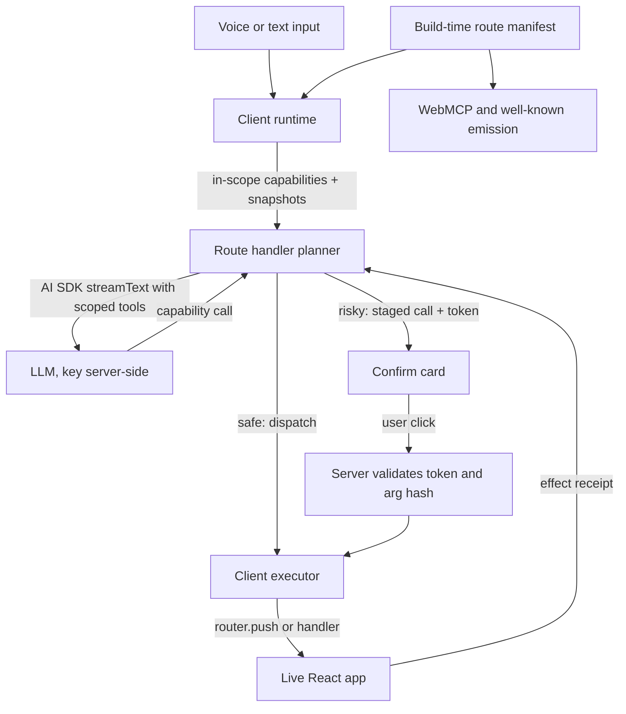

## 1. Restated problem

**For end users.** The gap is intent to action *inside an app they are already signed into*. A user knows what they want ("take me to billing", "start a post titled Launch Notes") but has to translate it into a path through someone else's navigation tree, forms, and modals. The user already has the auth, the permissions, and the session. What they lack is a way to say the thing.

**For developers.** There is no standard way for an app to state what it can do. Every team that wants AI operability rebuilds the same four things: a chat surface, a registry of "what's possible here", wiring into router/forms/modals, and a safety story for destructive actions. All four are re-derived per project, and the safety one is the one most likely to be gotten wrong quietly.

**Why the existing approaches do not close it.** This matters more than the idea, so it is worth being specific, including where prior art is simply better.

- **Browser-automation agents** (browser-use, Stagehand, Operator, WebVoyager-lineage). Strength: they need no cooperation from the site, which is exactly why they are the right answer for the open web. That is also their ceiling. They infer semantics from pixels and DOM, in a browser session that is not the user's, against sites that fight them. The reliability data is sobering: reported WebVoyager scores span 57.1% to 94.2% and are not comparable across runs; an independent re-run put Operator at 68.6% against the 87% originally reported; Agent-E scored 27.3% on Booking.com and 35.7% on Google Flights, precisely where dropdowns change based on prior selections; vision-based page reads cost 10-20x DOM parsing at 2-3s per page; WebArena success falls by over 70% under injected network faults. For *your own app*, guessing is strictly worse than being told, because you already know the answer at build time.
- **In-app support copilots** (Intercom Fin). Optimized for resolving and escalating support conversations, not operating a product. Fin Guidance explicitly cannot take actions on the conversation and cannot render or suppress UI elements; action-taking lives in Workflows and Procedures configured out of band. It answers questions *about* the app; it does not drive it.
- **UI copilot overlays and tour tools** (Chameleon, Guidejar). Tours are authored, static, and do not adapt when the user deviates. Chameleon's Copilot builds the *experiences*; the user still clicks. The closest real prior art is Chameleon Automations, which replay recorded click sequences on the user's behalf. But they are selector-recorded, authored one task at a time in a dashboard, not typed, not parameterized, and brittle against the markup they were recorded from.
- **CopilotKit.** The most direct overlap, and genuinely overlapping: `useFrontendTool` / `useCopilotAction` plus `useCopilotReadable` already constitute a client-side action registry with app-state context, and it is more mature than anything proposed here on generative UI and agent backends (LangGraph, CrewAI). What it does not do is treat the router as a source of truth. Nothing is route-aware, and context is a global store, which produces exactly the failure mode you would predict: issue #5369 documents ~30KB of A2UI catalog context injected into *every* agent run on an endpoint including agents with no related tool, and issue #2219 is developers asking for control over tool-list token cost. Capability declaration is also runtime-only, so there is no build-time artifact and no consumer other than its own copilot.
- **WebMCP** (`document.modelContext`). The standards-track-adjacent answer for exposing typed page tools to *browser-side* agents, and the right emission target. But it is a W3C Community Group draft with empty security and accessibility sections and "TODO" on all four core method definitions; it is an origin trial in Chrome 149+/Edge 150; Safari has formally opposed on API design, privacy, security, and duplication grounds; usage is ~0.78% of page loads; and the getter moved from `navigator` to `document` mid-flight. It is something to emit to, not something to build on.
- **Vercel AI SDK.** Owns the model loop, tool typing, streaming transport, and chat state (`AbstractChat`, `ChatState`, `ChatTransport`). It is infrastructure for talking to models, not a layer that knows what an app can do. We should sit on top of it, not beside it.

**So the actual, narrow gap:** nothing provides a *route-integrated, build-time-derivable, route-scoped* capability layer where one declaration serves several consumers (in-app assistant, browser agent, external agent) behind a deterministic safety gate. That sentence, not "AI that operates your app", is the problem worth solving.

## 2. How frameworks get designed (general)

**Deciding what belongs in the framework.** The durable test is three-part. Something belongs in only if it is (a) rebuilt near-identically in every app, (b) awkward or impossible from userland because it needs a privileged position in the build, render, or routing pipeline, and (c) a correctness or safety concern you do not want a thousand teams reimplementing. React owns reconciliation and leaves styling and data fetching alone. Next.js owns the file-system route convention and the server/client boundary specifically because only the build tool can see the file tree and the import graph. tRPC owns exactly one thing, type inference across the wire, and deliberately ships no auth, no validation library, no data layer. Anything failing the test is either a product decision or already has an ecosystem winner, and in both cases the framework should decline it.

**Convention versus explicit declaration.** The deciding question is whether the information already exists somewhere canonical such that inference is lossless and checkable. If yes, use convention: the file-system router is unambiguous, verifiable, and cheap, so making developers re-declare routes would be pure tax. If the information exists nowhere, or if guessing it wrong fails *silently*, require explicit declaration: tRPC procedures and AI SDK tool schemas are hand-written because no safe derivation exists. The corollary is the important part: **never infer something whose failure mode is invisible.** A wrong guess the developer cannot see is worse than a required declaration.

**Finding and validating the core abstraction.** Authors write the end-user code before the implementation, then hunt for the smallest noun that everything else can be expressed in terms of: component, procedure, tool, route. The abstraction is then stress-tested on four axes. Expressiveness: can every real case be said with it? Minimality: can any concept be deleted without losing expressiveness? Composability: does it nest and compose? Ownership: does having this noun let the framework take over meaningful plumbing on the developer's behalf? Only after it survives all four do ergonomics and tooling get built. The AI SDK demonstrates both directions of this discipline: it introduced the `Agent` abstraction in v6 only once inline configuration had *demonstrably* broken down at reuse scale, and it deleted the `chat-store` concept in v5 (-650 lines) with the explicit reasoning that the store "introduced unnecessary complexity" that a single chat instance handled better. Abstractions follow demonstrated pain and get removed when they stop earning their complexity.

**Extensibility without sprawl.** Provide one extension point per kind, not N bespoke hooks, and provide escape hatches down a layer rather than more options at the top. React has refs and portals; the AI SDK exposes `AbstractChat` so you can build your own framework binding and decouples state so you can bring Zustand or Redux. Keep the core small and push integrations into thin adapters: the WebMCP registry SDK keeps a single core holding the polyfill, registration, validation, and manifest generation, with per-framework adapters under 3KB that only manage lifecycle. Sprawl is what happens when each new use case gets a new top-level API instead of composing the existing noun.

## 3. Derived architecture

**Applying "derive what is canonical, declare what is dangerous."** This single rule splits the problem cleanly and explains the whole design.

- The App Router file tree is canonical, unambiguous, and build-visible. So **navigation is derived**, at build time, with zero developer work: route patterns, dynamic segments, and their types come out of the file system. This is the thing no userland library can do well and the highest-value, lowest-cost win available.
- An app's mutations exist nowhere canonical, and a wrong guess about them fails silently and possibly destructively. So **mutations are declared**, explicitly and typed. The framework will never infer an action from a DOM form or a recorded click.

**The core abstraction: `Capability`.** A typed, route-scoped, risk-classified, invocable unit: `{ id, describe, input, risk, scope, handler }`. Crucially, navigation is *not* a special case; it is a derived Capability whose handler is `router.push`. Running the four tests: it is expressive (navigation, mutation, read, and UI affordances like opening a modal are all capabilities); it composes (capabilities nest with the component tree and compose into multi-step turns); and it confers real ownership, because once the framework knows the capability set it can own scope resolution, the tool surface sent per request, the dispatch into React, the safety gate, and every emission format.

Minimality forces one honest concession. Ambient *reading* of state is not invocable and is token-costly, so it does not fit the Capability noun without distorting it. The design keeps a second, deliberately smaller noun, `Snapshot`: route-scoped, lazily serialized, and budgeted. The justification is empirical rather than aesthetic: CopilotKit's global context store is precisely the documented failure mode (~30KB into every run), scoping is the fix, and scoping requires context to be a separately resolvable thing rather than a global side effect.

**Framework-owned**, because each item satisfies the three-part test:

- Route manifest codegen from the App Router tree (needs build position).
- The capability registry keyed by mount point and route, and the scope resolver that answers "what is actually live right now, on this route, for this user" (needs render-tree position).
- The per-request tool surface, so the model is offered only in-scope capabilities (this is the token and misfire fix).
- The client executor that dispatches a model-chosen capability into React, plus the **effect receipt** it returns (route before/after, snapshot delta, handler result) so the model can verify what actually happened. This observation loop is what overlays and tour replays structurally lack.
- The policy gate, server-validated. This is a safety invariant, not a product choice.
- Emission adapters: WebMCP tool registration, `/.well-known/actions.json`, and an MCP server bridge.

**Developer-owned**, because each is a product decision or has an ecosystem winner:

- Which capabilities exist and what their handlers do.
- Risk classification (framework supplies defaults per kind; developer overrides).
- Model and provider choice, via the AI SDK.
- Auth and permission checks inside handlers; the framework cannot know your rules.
- The look of the assistant UI; we ship headless, unstyled primitives only.

**Execution split, given the key constraint.** Planning must happen server-side because LLM keys never reach the browser; execution must happen client-side because it needs the router, React state, and the DOM. That dictates a round trip, and the AI SDK's client-side tool execution (`useChat` with tool-call handling and `addToolResult`) is exactly the right primitive to build on rather than reinvent.



**Safety model.** The gate is architectural, not prompt-level, following OWASP AISVS C09-02 and the commit-token pattern used by Verflow and Agentheya. Capabilities default to least privilege. Anything above `safe` requires a server-issued grant bound to a hash of the exact arguments, with a short TTL, and the client executor refuses to dispatch without one. The threat model is not "the user bypasses their own UI" but "a prompt-injected model approves itself", which this structurally prevents. Gate deletes, disconnects, credential changes, and outbound sends; do not gate reads, drafts, idempotent toggles, or local UI changes, because over-gating turns the assistant into a permissions dialog. Sensitive handlers must still re-authorize server-side, and model output is always treated as untrusted input to a validated dispatch.

**Voice.** Text first. Voice ships as a thin adapter using the OpenAI Realtime API over WebRTC, where the backend mints a short-lived client secret (`POST /v1/realtime/client_secrets`) and the browser connects directly, so the project key stays server-side. The Web Speech API is not a substitute for the conversational loop and is not the default path.

## 4. Conclusion: what is in, what is out, and the MVP

### What belongs in, with reasons

- **Route manifest codegen (App Router).** Only the build layer can see the route tree; derivation is lossless and verifiable. Biggest value per unit of developer effort.
- **`defineCapability` + `useCapability`, route and mount scoped.** The core abstraction, and scoping is the concrete fix for a documented competitor failure mode.
- **Scope resolver and per-request tool surface.** Requires privileged render/route position; directly controls token cost and misfire rate.
- **Client executor with effect receipt.** Needs React internals; supplies the verification loop overlays lack.
- **Server-validated policy gate with commit tokens.** A safety invariant that must not be reimplemented per app.
- **Headless UI primitives and text input.** Minimum needed to be usable without making styling decisions for anyone.
- **Emission adapters (WebMCP, `/.well-known/actions.json`, MCP bridge).** The multi-consumer payoff that justifies declaring capabilities at all; one declaration, several audiences.

### What stays out, with reasons

- **Agent loop, provider abstraction, streaming transport.** The AI SDK owns these; duplicating them is exactly how API surfaces sprawl.
- **A styled chat UI kit.** A product decision with many valid shapes; CopilotKit and assistant-ui already serve it.
- **DOM scraping, visual inference, selector recording.** This defeats the trust model, because its failure mode is silent, and browser-use and Stagehand are simply better at it. If the developer did not declare it, the AI does not get it.
- **Autonomous multi-step planning across pages without user turns.** The reliability data does not support it. Cap steps and keep a human in the loop.
- **Evals, analytics dashboards, RAG, vector stores.** Separate products, not framework plumbing.
- **Any browser-side LLM key.** Non-negotiable constraint.
- **A new competing protocol.** Emit WebMCP; do not invent a rival. Equally, do not depend on it, given Safari's opposition and ~0.78% usage.
- **Non-React or non-Next adapters at MVP.** Prove the abstraction on one host first, the way thin adapters are added later over a stable core.

### Where this is honestly not better

If a site will not adopt the layer, browser-automation agents win outright and this approach offers nothing. If a team wants a support deflection bot, Intercom Fin is the correct purchase. If a team wants generative UI backed by LangGraph or CrewAI today, CopilotKit is more mature than this would be for a long while. The defensible wedge is narrow and should be stated as such: router-derived navigation, route-scoped execution with verification, a deterministic safety gate, and multi-consumer emission from a single declaration.

### MVP slice (proves the core abstraction end to end)

Defaults chosen so nothing is left open: Next.js App Router only, React 19, Vercel AI SDK, Zod schemas, text input first, voice adapter stubbed behind the server-minted-token path.

Packages:

- `@ai-nav/core`: `defineCapability`, registry, scope resolver, risk defaults, arg-hash and grant verification, manifest types.
- `@ai-nav/react`: `AINavProvider`, `useCapability`, `useSnapshot`, client executor, headless `ConfirmCard` and `AssistantInput`.
- `@ai-nav/next`: route-manifest codegen plugin, `createNavHandler` for the planner route, `/.well-known/actions.json` route helper.
- `examples/next-demo`: App Router app with `/billing`, `/posts`, `/posts/new`, `/posts/[id]`, one declared mutation, one destructive capability.

Developer-facing API to build against:

```ts
// capabilities/posts.ts
export const createPost = defineCapability({
  id: 'posts.create',
  describe: 'Start a new draft post with an optional title',
  input: z.object({ title: z.string().max(200).optional() }),
  risk: 'safe',
  scope: { routes: ['/', '/posts', '/posts/*'] },
});
```

```tsx
'use client';
useCapability(createPost, async ({ title }, ctx) => {
  const id = await createDraft({ title });
  ctx.navigate(`/posts/${id}`);
  return { postId: id };
});

useSnapshot('currentPost', () => ({ id: post.id, title: post.title, status: post.status }), [post]);
```

```ts
// app/api/ai/route.ts
export const POST = createNavHandler({ model: openai('gpt-4.1') });
```

`nav.goto` is not written by the developer; it is generated from the route manifest with a typed enum of known routes and params.

Success criteria, all verifiable in the demo app:

- "take me to billing" navigates via the derived capability with no action authored by the developer.
- "start a new post titled Launch Notes" creates a draft and lands on it, and the effect receipt reflects the route change.
- "delete this post" renders a confirm card and deletes only after a click; no server grant means no dispatch.
- Text injected into post *content* cannot trigger the destructive capability without a human click.
- The in-scope tool count on `/billing` is measurably smaller than the global set, with a recorded token delta against an unscoped baseline.
